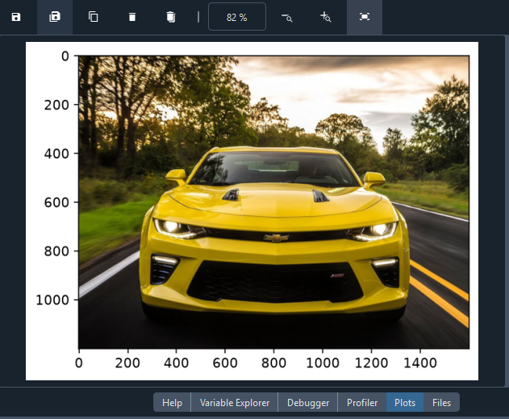

In this post I'm going to run through a function in Python that 

---


```ruby
import numpy as np
from skimage import io
import matplotlib.pyplot as plt
```
Let's get this image to generate

```ruby
camaro = io.imread("camaro.jpg")
print(camaro)

camaro.shape

plt.imshow(camaro)
plt.show()

```




